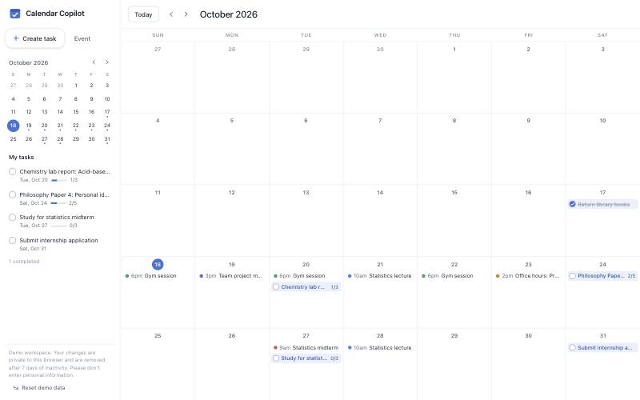
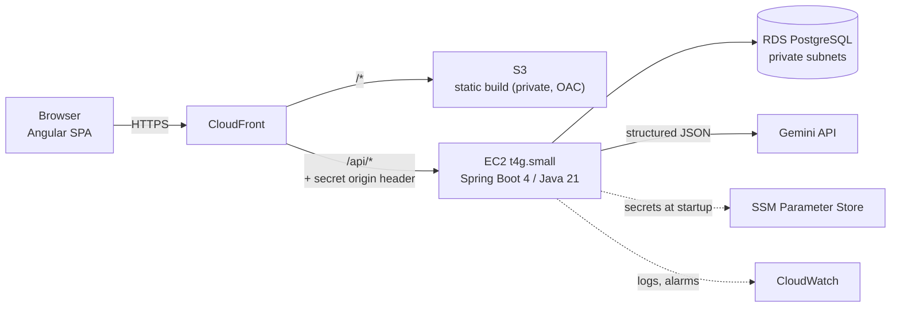
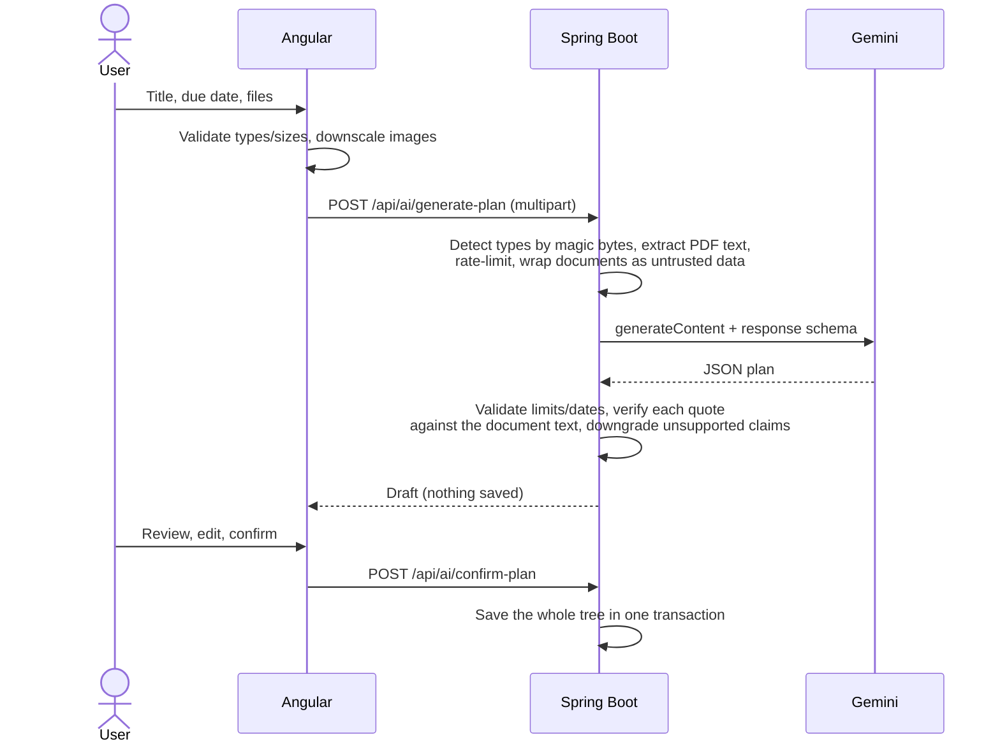

# Calendar Copilot

A calendar with **hierarchical tasks** and **optional AI-assisted planning**. Upload an assignment's instructions or rubric, and Gemini drafts a task breakdown. Every requirement it extracts is checked against your documents, and nothing is saved until you review and confirm it.

**Stack:** Java 21 · Spring Boot 4 · Angular 22 · PostgreSQL · Gemini API · AWS (CloudFront, S3, EC2, RDS) · Terraform

> **Live demo:** _link added after deployment_ · Opens straight into a private demo workspace with sample data. No sign-up.



---

## Why I built it

Calendars tell you *when* something is due, not *what* it takes to finish. "Complete Philosophy Paper 4" is a single block on a calendar, but in practice it's a dozen steps hidden in a rubric. Calendar Copilot turns that block into a tree of tasks you can check off.

I also built it to learn a stack I had less experience with (Java/Spring Boot, Angular and AWS), coming from Python, Go and AI-agent work. The AI piece applies my research on hierarchical task decomposition, but kept deliberately simple: **one grounded model call plus deterministic verification**, not a multi-agent system.

## Features

- **Month calendar.** Navigation, today highlight, tasks and events on their dates, mini calendar, and a "My tasks" sidebar with progress bars.
- **Task hierarchy.** Tasks contain subtasks, up to three levels. You can create, edit, complete and delete them (deletes cascade), and expand or collapse levels. Progress rolls up from every level.
- **Events.** Time-boxed entries with colors, kept distinct from tasks.
- **Drag to reschedule.** Drag a task or event to another day. Tasks keep their due time, and events keep their time and duration.
- **AI planning (optional).** Upload a PDF, PNG, JPEG or TXT as assignment instructions, a rubric or supporting material, and add optional context. Then:
  - **Review** the extracted requirements, each with its source quote and verification status.
  - **Edit** the draft: rename, re-date, remove or add steps.
  - **Confirm** to save. Drafts are visually marked ("AI Draft", dashed borders) until then.
- **Private demo workspaces.** Every visitor gets an isolated, pre-filled workspace. Visitors can't see or overwrite each other's data.

## Architecture



One CloudFront distribution serves both the app and the API from the same origin:
- HTTPS without buying a domain.
- No CORS configuration.
- Static files are served from edge locations close to the user.

The API instance only accepts traffic from CloudFront, and the database only accepts traffic from the API instance. Infrastructure is defined in [Terraform](infra/terraform). See [infra/README.md](infra/README.md) for cost and operations.

### AI planning flow



## Key design decisions

| Decision | Why |
|---|---|
| **Anonymous guest workspaces** instead of accounts | A recruiter can try it in one click. Every query is scoped by an unguessable workspace ID, and idle workspaces are deleted after 7 days. An `owner_id` column is ready for sign-in (Cognito: Google + email OTP) later. |
| **Adjacency list** (`parent_id`) with `ON DELETE CASCADE` | The simplest flexible tree. The API returns a flat list and the client builds the tree, so each read is a single indexed query with no lazy-loading or N+1 queries. |
| **Structured output + server-side validation** | Gemini must follow a JSON schema. The server still re-checks everything: at most 5 tasks × 5 subtasks, no blank or duplicate items, dates between today and the due date, and references only to requirements that exist. Malformed output is retried once. |
| **Deterministic citation verification** instead of a second "judge" model | Each extracted requirement must include an exact quote. The server checks that the quote really appears in the cited document, ignoring case, whitespace and typographic differences. Requirements that fail are flagged **"Not found in your files"**, and tasks claiming to come from them are downgraded to "Suggested". It's cheap, fast and explainable. It catches invented requirements, but it can't prove a requirement was interpreted correctly, so the user still reviews everything. |
| **Human in the loop** | Generate → review → edit → confirm. Drafts live only in the browser until confirmed, and the confirmed plan is saved in one transaction. |
| **Prompt-injection hygiene** | Uploaded text is wrapped in `<document>` tags that cannot be closed early. The system instruction says document content is data, never instructions. Output is constrained by a schema, and a person reviews it before it takes effect. |
| **Upload safety** | Types are detected from the file's first bytes, never from its name. Size, file-count and page limits are enforced. Encrypted PDFs are rejected. Files stay in memory for one request and are never stored or executed. Logs record types and sizes only, never content. |
| **Cost and abuse controls** | Sliding-window limits per workspace (5/hour), per IP (20/hour) and globally (200/day), plus a cap on concurrent generations. The Gemini key exists only on the server. |
| **Concurrency** | `@Version` optimistic locking turns overlapping writes into a 409 instead of silently losing one. The UI sends writes to the same item in order and ignores responses that a newer edit has superseded. Requests run on virtual threads, and the 5–20 s Gemini call never holds a database connection. |
| **Fast by default** | Data loads once and month navigation never hits the network. Edits update the UI immediately and roll back on error. The AI planner is lazy-loaded (`@defer`), so the initial bundle is about 66 KB gzipped. |
| **EC2 + RDS** rather than Lambda, ECS or Elastic Beanstalk | Simplest to run reliably for an always-on Spring Boot app. No cold starts, no API Gateway 29 s timeout to fight for long AI calls, and no RDS Proxy. No NAT gateway: only the database lives in private subnets. |
| **REST `RestClient` instead of an AI SDK** | Explicit timeouts and error mapping, easy to test against a local HTTP server, and no hidden behavior. |

## API

All `/api` data endpoints require an `X-Workspace-Id` header. Errors use RFC 7807 problem details.

| Method | Path | Purpose |
|---|---|---|
| `POST` | `/api/workspaces` | Create a demo workspace (seeded with sample data) |
| `GET` | `/api/workspaces/current` | Check that the stored workspace still exists |
| `GET` | `/api/tasks` | All tasks in the workspace (flat; tree via `parentId`) |
| `POST` | `/api/tasks` | Create a task, or a subtask with `parentId` |
| `PATCH` | `/api/tasks/{id}` | Partial update (`clearDueAt` / `clearStartAt` remove dates) |
| `DELETE` | `/api/tasks/{id}` | Delete a task and its subtasks |
| `GET` `POST` | `/api/events` | List or create events |
| `PATCH` `DELETE` | `/api/events/{id}` | Update or delete an event |
| `POST` | `/api/ai/generate-plan` | Multipart: `title`, `dueAt`, `context`, `timeZone`, `instructions[]`, `rubric[]`, `supporting[]`. Returns a draft; nothing is saved. |
| `POST` | `/api/ai/confirm-plan` | Save a reviewed plan (new root task, or `parentTaskId`) |
| `GET` | `/api/health` | Health check |

## Project structure

```
backend/            Spring Boot API, package-by-feature
  …/workspace/      guest workspaces, demo seed data, nightly cleanup
  …/task/           task hierarchy, plan persistence
  …/event/          calendar events
  …/ai/             uploads, PDF extraction, Gemini client, prompt and schema,
                    plan validation, citation verification, rate limiting
  …/common/         errors (RFC 7807), origin verification, client IP
  src/main/resources/db/migration/   Flyway schema
frontend/           Angular 22 (standalone components, signals, zoneless)
  src/app/core/     API client, signals store, date utilities
  src/app/calendar/ month grid
  src/app/sidebar/  mini calendar, My tasks
  src/app/task-modal/  task form and recursive subtask tree
  src/app/ai-planner/  upload → progress → review/edit → confirm
infra/              Terraform (VPC, CloudFront, S3, EC2, RDS, SSM, CloudWatch)
                    and deploy scripts
docker-compose.yml  local PostgreSQL
```

## Run locally

**Prerequisites:** Java 21, Node 24 (`nvm use` reads `.nvmrc`), Docker.

```bash
# 1. Database
docker compose up -d

# 2. Optional: enable AI planning with a Gemini API key from Google AI Studio
cp .env.example .env        # then set GEMINI_API_KEY in .env (gitignored)

# 3. API on :8080 (reads ../.env automatically)
cd backend && ./mvnw spring-boot:run

# 4. Web app on :4200 (proxies /api to :8080), in a second terminal
cd frontend && nvm use && npm install && npm start
```

Open http://localhost:4200. Without a Gemini key, everything works except AI generation, which returns a clear "not configured" message.

## Tests

```bash
cd backend && ./mvnw test              # needs Docker (Testcontainers PostgreSQL)
cd frontend && npx ng test --watch=false
```

- **Backend: 58 tests.** Task and event CRUD, hierarchy depth and cascade deletes, cross-workspace isolation, validation errors, PDF and image detection and limits, citation verification, plan validation and limits, Gemini client behavior (schema request, provider errors, blocked content, timeouts) against a real local HTTP server, retry on malformed output, rate limits under 50 parallel threads, optimistic locking under concurrent writers, and confirm-plan persistence.
- **Frontend: 17 tests.** Month grid math, offset-aware dates, DST-safe drag rescheduling, the hierarchy and progress rollup, optimistic updates with rollback, ordered per-item writes, and draft-to-request mapping.

## Deployment

Terraform provisions everything in `us-east-2`, and two scripts deploy the backend and frontend. That's about $35/month (less with free-tier credits), and `terraform destroy` removes it all. See [infra/README.md](infra/README.md).

## Limitations and next steps

- **Sign-in:** Cognito with Google and email one-time codes; claim the guest workspace on first sign-in.
- **Streaming:** stream generation so steps appear as they're written.
- **Partial regeneration:** regenerate a single step with feedback. Also a week view, and drag-and-drop on touch screens.
- **Hardening for scale:** private EC2 behind CloudFront VPC origins, Multi-AZ RDS, WAF rate rules, Redis-backed rate limits for multiple instances, and deploys from GitHub Actions with OIDC.
- **Verification limits:** citation checks cover text documents. Requirements read from images or scanned PDFs are marked "not checked" rather than verified.

## Notes

- This is a personal portfolio project. It isn't affiliated with Google or any employer, and it isn't a certified educational records system, so please don't upload personal or sensitive information.
- All demo content is fictional.
- Built with AI-assisted development (Claude Code). I made the architecture and product decisions and reviewed and tested the code.
